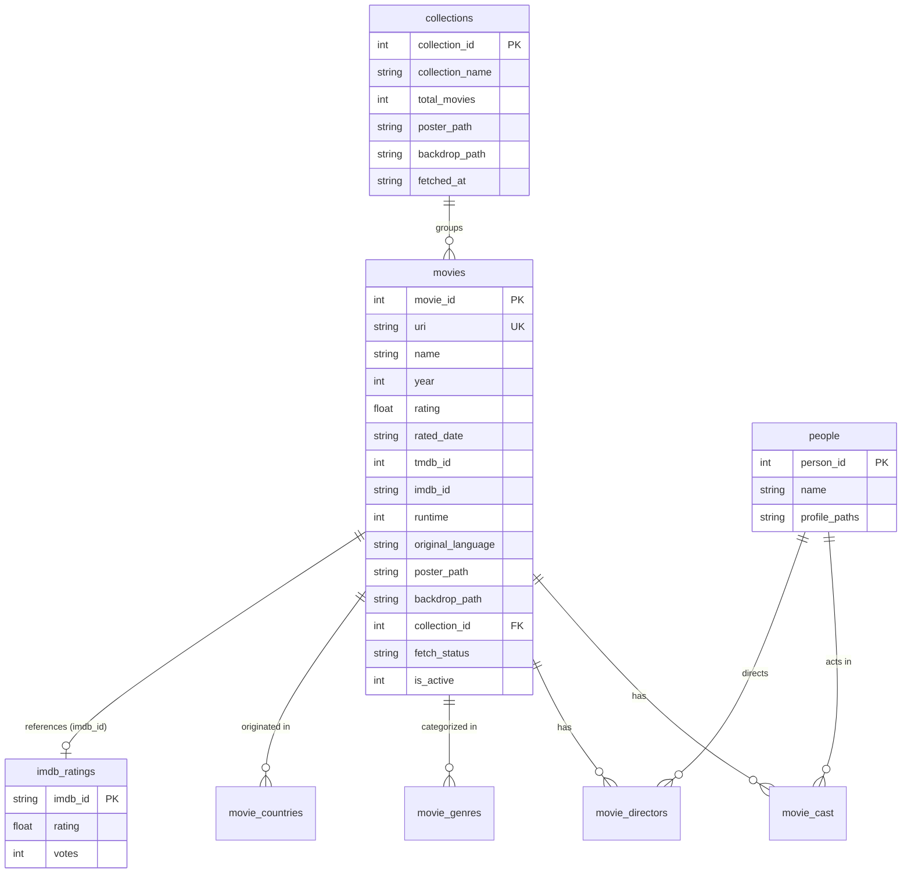

# Letterboxd Data Analyzer

An end-to-end data pipeline and interactive visual analytics dashboard for personal **Letterboxd** exports. The application parses your Letterboxd ratings, enriches them with official **TMDb (The Movie Database)** metadata and **IMDb (Internet Movie Database)** ratings, and displays interactive statistics via a **Streamlit** dashboard.

---

## Key Features

- **Tkinter Export Selector**: Automatically detects the latest export in `data_exports/` or lets you select any custom export folder. Warns you if the selected folder is newer than previously imported data.
- **TMDb API Metadata Enrichment**:
  - Exact title matching with popularity fallback.
  - Automatic `year ± 1` retry logic for movies with mismatched international release years.
  - Ingests genres, runtime, language, posters, backdrops, top 25 cast members by billing order, and directors.
  - Tracks movie franchises (`collections`) and counts released parts.
- **Official IMDb TSV Ratings Integration**:
  - Ingests the official IMDb title ratings dataset (`title.ratings.tsv.gz`).
  - Staging table with atomic swap prevents data loss on failure.
  - Automatically checks dataset age and prompts for refresh if older than 30 days.
  - Joins ratings at query time to keep movie metadata clean.
- **Localization (pycountry)**: Automatically converts ISO 3166-1 country codes and ISO 639 language codes into full names (e.g. `US` → `United States`, `en` → `English`, `te` → `Telugu`), with fallbacks for legacy/TMDb codes (`cn`, `xx`, `SU`).
- **Relational SQLite Database**:
  - `PRAGMA foreign_keys = ON` enforced on every connection.
  - Normalized link tables: `movie_cast`, `movie_directors`, `movie_genres`, `movie_countries`, `people`, and `collections`.
  - `active_movies` SQL view ensures statistics reflect currently active ratings.
- **Interactive Streamlit Dashboard**:
  - Rating distribution (1 to 10 scale).
  - Release year distribution with **Year / Decade** toggle.
  - Top genres, countries, languages, and release years with **Most Watched / Highest Average Rating** toggle (applies $\min(10, 5\%)$ threshold).
  - Most watched actors and directors with average ratings.
  - Rating divergence vs. IMDb average ($\ge 1,000$ votes) highlighting movies you loved or disliked compared to the global consensus.
  - Franchise completion progress bars (watched $X$ of $Y$ released parts).
  - Searchable and filterable movie explorer table.

---

## Project Structure

```text
Letterboxd Data Analyzer/
│
├── core/                           # Core data pipeline modules
│   ├── config.py                   # Paths, API keys, and settings
│   ├── database.py                 # SQLite connection, schemas, and views
│   ├── export_selector.py          # Tkinter GUI export folder selection & warning
│   ├── imdb.py                     # IMDb dataset download, gunzip & staging swap
│   ├── localization.py             # pycountry ISO country & language code resolver
│   ├── main.py                     # Ingestion pipeline (Steps 1, 2, and 3)
│   ├── movie.py                    # Movie dataclass definition
│   ├── stats.py                    # Analytical SQL queries & CLI dashboard
│   └── tmdb.py                     # TMDb search, details & collection API client
│
├── dashboard/                      # Interactive Streamlit Web Application
│   ├── __init__.py                 # Dashboard package marker
│   ├── app.py                      # Streamlit application UI & interactive charts
│   └── queries.py                  # Optimized SQL queries reading active_movies view
│
├── database/                       # SQLite storage
│   └── letterboxd.db               # SQLite database file
│
├── data_exports/                   # Export directory
│   ├── export_settings.json        # Stored export metadata & last selected folder
│   ├── letterboxd-*-utc/           # Letterboxd export folders containing ratings.csv
│   └── ...
│
├── imdb_dataset/                   # Local IMDb TSV storage
│   ├── title.ratings.tsv.gz        # Compressed official dataset
│   └── title.ratings.tsv           # Gunzipped TSV for high-speed staging ingestion
│
├── run.py                          # Unified launcher (menu, ingestion, dashboard)
├── run.bat                         # 1-click Windows launcher batch script
├── requirements.txt                # Python package dependencies
├── .env                            # API tokens (TMDb)
└── README.md                       # Project documentation
```

---

## Getting Started

### 1. Prerequisites

- Python 3.10+ (tested on Python 3.14)
- A free [TMDb (The Movie Database)](https://www.themoviedb.org/) API Read Access Token

### 2. Installation

1. **Clone or navigate to the project directory:**
   ```bash
   cd "d:/Documents/My Projects/Letterboxd Data Analyzer"
   ```

2. **Create and activate a virtual environment:**
   ```powershell
   python -m venv .venv
   .\.venv\Scripts\Activate.ps1
   ```

3. **Install dependencies:**
   ```powershell
   pip install -r requirements.txt
   ```

4. **Configure Environment Variables:**
   Create or edit the `.env` file in the root directory:
   ```env
   TMDB_TOKEN=your_tmdb_bearer_token_here
   ```

---

## How to Run

### Method 1: Unified Launcher (Recommended)

Run the unified launcher to choose whether to sync data or open the dashboard directly:

```powershell
python run.py
```

This presents an interactive menu:
```text
==========================================================
        🎬 LETTERBOXD DATA ANALYZER LAUNCHER
==========================================================
  [1] Ingest Data & Open Dashboard (Default)
  [2] Open Dashboard Directly (View Previous Data)
  [3] Ingest Data Only (Run main.py without Dashboard)
  [4] Exit
==========================================================
```

Or pass flags directly:
- **View Dashboard using existing data:**
  ```powershell
  python run.py --dashboard
  ```
- **Run data ingestion only:**
  ```powershell
  python run.py --ingest
  ```
- **Run ingestion (using latest export) and launch dashboard:**
  ```powershell
  python run.py --all --latest
  ```

### Method 2: One-Click Windows Batch File

Double-click `run.bat` in Windows Explorer to launch the interactive menu immediately.

### Method 3: Direct Script Execution

- **Run the Ingestion Pipeline:**
  ```powershell
  python core/main.py
  ```
  *(Opens the Tkinter folder selector dialog if `--latest` or `--folder` is not provided).*

- **Run the Streamlit Dashboard Directly:**
  ```powershell
  streamlit run dashboard/app.py
  ```

---

## Database Architecture

The SQLite database (`database/letterboxd.db`) uses strict relational normalization:



- **`active_movies` View**:
  ```sql
  CREATE VIEW active_movies AS SELECT * FROM movies WHERE is_active = 1;
  ```
  All dashboard statistics query `active_movies`, automatically handling additions and deletions between export versions.

---

## Dashboard Overview

The **Streamlit** dashboard (`dashboard/app.py`) provides:
1. **Summary KPIs**: Total watched count, average rating, watch time (hours & days), unique actors & directors, and tracked collections.
2. **Ratings & Release Timeline**: Vertical rating distribution (1–10) and release timeline with Year vs. Decade toggle.
3. **Genres, Countries & Languages**: Horizontal frequency charts with Most Watched vs. Highest Average toggles and pycountry localization.
4. **Cast & Crew**: Most watched directors and actors with rating averages.
5. **IMDb Divergence**: Films you rated significantly higher or lower than the IMDb community ($\ge 1,000$ votes).
6. **Franchises**: Completion progress bars for collections (e.g. *John Wick*, *Avengers*, *Pirates of the Caribbean*).
7. **Movie Explorer**: Interactive table with real-time title search and star rating filters.

---

## License

This project is intended for personal use and film data analysis. Data is sourced from Letterboxd exports, TMDb API, and IMDb Datasets under their respective terms of service.
